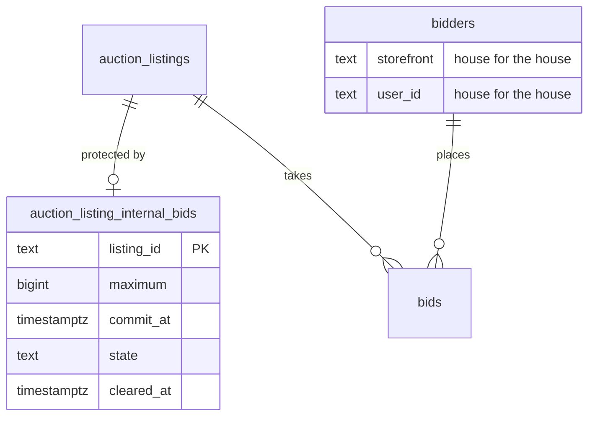

## Context

The auction service already holds every piece the internal bid needs except
the house itself. Motivation is in [proposal.md](proposal.md).

- **One serializer** - every money transition on a lot runs under
  `SELECT … FOR UPDATE` on its `auction_listings` row (`withListingLock`).
  Bids are rows in `auction.bids`, keyed to a bidder by
  `(storefront, user_id)`, each carrying `maximum` and its resolved `amount`
- **One resolution** - `acceptBid` → `resolveStandingMaxima` resolves an
  incoming maximum against the standing ones once, writes the bid rows, the
  bid action group (public and private history) and the extension. A raise
  inserts a superseding row and cancels the old one
- **Clock and settle** - `settleIfDue` commits whichever of publish, extended
  bidding entry or close is due. The lot's `AuctionRoom` Durable Object arms
  one alarm at `nextDeadlineAt` and calls `ROOM_WORK.settle`; a read or a
  refused late bid defers a settle; the five-minute sweep (`sweeps/close.ts`,
  `sweeps/publish.ts`) is the net
- **Close** - `applyClose` moves the top bid to `won`, issues the winner order
  and its mail, then `markUnsoldStockDue` marks the release owed only when
  `isUnsoldForRelease()` holds (no `won` bid, no top bid)
- **Listing edits** - only `draft` and `created` listings change their window,
  starting price or currency, through `listings.save`
  (`services/listings/draft.ts`, which refuses them as `FLOOR_LOCKED` once
  published) and, for the window, `listings.updateSchedule`
  (`services/listings/schedule.ts`), both under the listing lock and both open
  to `auction:operate`, which `staff` holds. A currency change keeps the
  starting price's count of minor units
- **Publish** - a `created` listing with no publish at stays `created` past
  its start until an operator publishes it; one with a publish at is
  published by `settleIfDue` when that time arrives
- **Operator reads** - `listings.bidHistory`, `listings.bidderSummaries` and
  `listings.stats` need `auction:read`; `listings.activity` needs
  `auction:operate`. The first two return each bidder's account (storefront,
  user id, email, name) and maximum; activity also replays audit rows. The
  Listings table's views come from `LISTING_VIEWS`, decided by
  `listingViewOf` and its SQL twin `listingViewSql`, and its `q` matches a
  counted bidder's email
- **Secret floor grant** - `auction:reserve` exists in
  `packages/grade10-auth/contracts`, held by `admin` only, read nowhere. The
  shared tRPC audit middleware writes the raw input unless a procedure
  declares `auditDetails`
- **Leaks to close** - a lot's listing row feeds public projections and its
  version trigger relays to every open page; the room's `inspect` reports its
  armed alarm

## Goals / Non-Goals

**Goals:**

- The house bids through the same resolution, history, extension and close
  code as a collector, so the two-maximum rule cannot drift between them
- The internal bid's amount and time never reach a public read, a listing
  version, or an operator read without `auction:reserve`; no such read
  shows that a lot has an internal bid before the house has bid, and
  afterwards it shows the house's public bids as House and nothing more
- The commit is deterministic: whichever writer reaches the lot first, the
  house's commitment lands at its set time, before anything accepted after it

**Non-Goals:**

- A second resolution engine, or a house bid outside `auction.bids`
- Reporting or exports beyond the Bought in label, its view and Stats

## Decisions

The specs govern what the house may do and what each reader sees:
[`grade10-site/auction/auto-bidding`](specs/grade10-site/auction/auto-bidding/spec.md)
the bidding rules and the trace,
[`grade10-admin/auction/internal-bid`](specs/grade10-admin/auction/internal-bid/spec.md)
the admin flow, its states, the listing-edit clear and what each operator reads,
[`grade10-site/auction/auction`](specs/grade10-site/auction/auction/spec.md)
the close,
[`grade10-site/auction/notifications`](specs/grade10-site/auction/notifications/spec.md)
the letters, and
[`grade10-admin/auction/listing`](specs/grade10-admin/auction/listing/spec.md)
the Listings table, its Bought in view, stock and Relist. These are the
implementation choices.

1. **The house is a bidder row, not a second engine.** One seeded
   `auction.bidders` row, `(storefront 'house', user_id 'house')`, bids
   through `acceptBid` on every listing. Its per-listing pseudonym is the
   existing `pseudonym_seq`, assigned at its first commit like anyone's.
   `HOUSE_BIDDER` and `isHouseBid(row)` live in the backend's schema module
   so every reader asks one predicate.
   - Rejected: a `house_bids` table resolved beside `bids`. It duplicates the
     two-maximum rule, ties, extension and history, which is exactly what must
     stay identical.
   - Rejected: a bidder row per listing. It multiplies a row nobody reads and
     still needs the same exclusion predicate.

2. **The internal bid lives in its own table.** `auction_listing_internal_bids`
   holds the amount, time and state, one row per listing; a save upserts it,
   so there is never a second. Nothing public joins it, no version trigger
   watches it, and Relist copies listing columns only, so the draft cannot
   carry it.
   - Rejected: columns on `auction_listings`. Every public projection, the
     version trigger and the Relist copy read that row, so secrecy would rest
     on remembering to strip three columns everywhere.

3. **Save checks what is known at Save; the commit checks the price.**
   `saveInternalBid` refuses a `draft`, `closed`, `settled` or `canceled`
   listing, an amount that is not whole in the currency
   (`currencyExponent` in `packages/utils/src/money.ts`, as the custom
   maximum uses), below the starting price or above `bidCeiling`, and a time
   outside `[starts_at, scheduled_ends_at]` (both included) or not after
   now. It never reads the minimum next bid for a `scheduled` row; the commit
   does.

4. **Commit before judge.** `commitDueHouseMaximum(tx, listing, now)` runs at
   the head of every writer that holds the listing lock and moves money or
   lifecycle state: `placeBid`'s judgement, `settleIfDue` (publish at, start,
   extended-bidding entry, close), the operator's publish, the listing edits
   of Decision 8, the erasure re-stand, and the internal bid's own writers.
   It commits a `scheduled` row whose `commit_at <= now`, with the house
   bid's `created_at` set to `commit_at`, judging the listing as it stood at
   `commit_at`: `settleIfDue` applies a publish at due at or before
   `commit_at` first, and a listing still `created` at `commit_at` makes the
   row `not_placed`. Because every later acceptance commits it first, nothing
   is ever accepted between `commit_at` and the commit, so ordering and ties
   are the same whoever triggered it, and a later publish finds the row
   already decided.
   - Rejected: commit only from the room alarm. A collector bid landing in
     the alarm's latency would be judged without the house, and the result
     would depend on timing.

5. **The room alarm is the trigger; the sweep is the net.** `settleIfDue`
   returns `nextDeadlineAt = min(clock deadline, commit_at of a scheduled
   internal bid)`, so the lot's room wakes at the commit time and the commit
   relays like any bid. `sweeps/internalBids.ts` commits every `scheduled`
   row past its time that nothing reached, through `settleIfDue`, in the
   existing five-minute pass. The room's `inspect` answer reports the lot's
   clock deadline, not the raw armed alarm, so an operator never sees an
   alarm at the commit time.
   - Rejected: the sweep alone. Up to five minutes late is too coarse for a
     commit that may sit seconds before the scheduled close.

6. **Not placed is decided once, at the commit.** The commit runs the
   collector rules - the listing takes bids, the minimum next bid and the
   accepted-tie rule - with the stored amount. A refusal, including a
   listing still `created`, writes no bid and sets the row to `not_placed`
   with `resolved_at`. On a `not_placed` row, any save under the Save rules,
   the same amount included, on a listing that takes no bids only updates
   the row; on one that takes bids, an amount at or above the minimum next
   bid is a fresh commit at `now` through the same path, and one below it is
   refused with `minimumNextAmount`. A removal only updates the row (no bid,
   no relay, no letter).

7. **A lower is a superseding commitment.** The service re-runs the
   two-maximum resolution in memory with the lower house maximum and the
   house's commitment time set to now. It accepts only when the leader's bid
   row and `top_amount` would be unchanged and the amount is at least the
   highest `amount` on any house bid row on the listing. It then writes as a
   raise does: a new house row at the same amount and state, the old one
   `canceled`, a private `automatic_max_lowered` action and no public record.
   The bid ledger therefore lists every commit, raise and lower with its
   Accepted At, which the reserve holder's trace reads.
   - Rejected: updating `maximum` in place. The ledger would lose the
     previous maximum and its Accepted At.

8. **A listing edit clears in the same transaction.** `listings.save` and
   `listings.updateSchedule` call `clearInternalBidOutsideLimits(tx, listing,
   next, now)` after their own validation, inside the lock they already hold,
   with the window, starting price and currency the save leaves. A
   `scheduled` or `not_placed` row on a `created` listing becomes `cleared`
   with `cleared_at` when its `commit_at` falls outside the window, its
   `maximum` is below the starting price, or its `maximum` is above
   `bidCeiling` of the new currency; `maximum` keeps its count of minor
   units, as the starting price does. The caller's answer and audit row are
   unchanged, so `staff` learn nothing; the reserve holder reads the
   `cleared` row through `listings.internalBid.get`. Grade10's own clear
   writes no audit row of its own, since the operator's save is already
   audited.
   - Rejected: refusing the edit. It tells staff the lot is protected.
   - Rejected: judging the amount at the commit time. An over-ceiling
     amount would stay stored and readable until then.

9. **Bought in is derived, not stored.** A closed listing whose `won` bid is
   the house's is bought in. `applyClose` moves the house bid to `won` as for
   any winner, which keeps every public reader on its sold path, and skips
   `issueWinnerOrder`, its order mail and Auction Won analytics.
   `isUnsoldForRelease()` widens to "no `won` bid, or the `won` bid is the
   house's", with release reason `bought-in close` and remark "Released by
   bought-in listing". Relist's source check accepts either, with the same
   campaign, relisted and release checks. `LISTING_VIEWS` gains `bought_in`;
   `listingViewOf` and `listingViewSql` take a server-side `houseTop` input
   and return `bought_in` only for an ended lot whose top bid is the house's,
   so `won` and `unsold` never hold one. The admin outcome gains
   `bought_in`.
   - Rejected: a `bought_in` listing status. It would fork every public
     reader that maps status to Ended and sold.
   - Rejected: shipping `houseTop` on the admin listing item. A live row
     would say who leads, which the Listings table keeps off its rows.

10. **The house is never a recipient.** Every mail and push claim joins
    `bidders` and excludes `storefront = 'house'` through one SQL fragment.
    The mail dispatcher throws on a house recipient, so a missed claim fails
    loudly instead of sending. House bid rows are written with push and mail
    stamps already set, so the partial notify indexes never hold them.
    Collectors' letters use their existing claims unchanged, which already
    send nothing for a write with no public bid record.

11. **One door, one redaction.** `listings.internalBid.{get,save,remove}` are
    `listingProcedure("auction:reserve")`. Their `auditDetails` file
    `{ listingId, act }` with `act` one of `set`, `changed`, `removed`,
    `raised`, `lowered` - never the amount or the time. Every operator read
    that lists bids or bidders - bid ledger, bidder summaries and lot
    activity - passes its rows through one `redactHouse(caller)` step in
    `services/admin`. A house row carries `house: true` and no
    `pseudonymSeq` for every caller, so the console labels it House:

    | Caller | House rows | Ledger counts | Internal-bid audit acts and private house actions |
    | --- | --- | --- | --- |
    | Holds `auction:reserve` | Every commitment, raise and lower, with `maximum` and the seeded bidder's account | As stored | Shown |
    | Does not | Only house rows the public history records as a bid, with `bidder: null` and `maximum: null`; amount, Accepted At, source and state kept | `total` and `canceled` recounted without the dropped rows | Dropped |

    A listing with no house bid row returns exactly what it returns today,
    whatever its internal bid's state, so a `scheduled`, `not_placed` or
    `cleared` row leaves no trace. Stats count every bidder and public bid
    as they do today, so the house counts once it has bid. The bidder
    moderation list and the Listings table's email search exclude the house
    through the shared fragment, for every caller.
    - Rejected: a pseudonym with no account for staff, round 2's rendering.
      A row with no account stands out anyway, and Q25 names it House.
    - Rejected: blanking the house's account fields to empty strings. A
      blank looks like an erased account, which is a different fact.

12. **House checks are a separate entry, not flags on `placeBid`.**
    `commitHouseMaximum` calls `acceptBid` after the ceiling and minimum next
    bid checks only: no registration, card, enrollment, suspension, ban,
    watch, idempotency key or Mixpanel Bid Placed event. `placeBid` stays
    unchanged for collectors and refuses `storefront = 'house'` at its entry.

## Database Schema

Owning table: `auction.auction_listing_internal_bids`. Affected:
`auction.bidders` (one seeded row), `auction.auction_listings` (stock release
reason check), `auction.bids` (no column change).

| Column | Type | Null | Default | Note |
| --- | --- | --- | --- | --- |
| `listing_id` | `text` | No | - | Primary key, FK `auction_listings.id` |
| `maximum` | `bigint` | No | - | Minor units in the listing's currency, `> 0`; whole and ceiling checks are the service's, by currency |
| `commit_at` | `timestamptz(3)` | No | - | The set time |
| `state` | `text` | No | `'scheduled'` | `scheduled`, `placed`, `not_placed`, `cleared`, `dropped` |
| `resolved_at` | `timestamptz(3)` | Yes | - | When the commit placed it or found it short |
| `cleared_at` | `timestamptz(3)` | Yes | - | When a listing edit cleared it |
| `updated_by` | `text` | No | - | Operator user id of the last save |
| `created_at` | `timestamptz(3)` | No | `now()` | |
| `updated_at` | `timestamptz(3)` | No | `now()` | |

- **Constraints** - `ck_internal_bids_state`, `ck_internal_bids_maximum`
  (`maximum > 0`), `ck_internal_bids_resolved` (`resolved_at` set exactly
  for `placed` and `not_placed`), `ck_internal_bids_cleared` (`cleared_at`
  set exactly for `cleared`)
- **Index** - `idx_internal_bids_due` on `(commit_at)` where
  `state = 'scheduled'`, for the sweep
- **No version trigger** - deliberately; a save before the time must not
  relay to open pages
- **`ck_auction_listings_stock_release`** - reason set gains `bought-in close`
- **Seed** - `insert into auction.bidders (storefront, user_id, email)
  values ('house', 'house', 'house@invalid') on conflict do nothing`
- **Removal** - removing a `scheduled` or `not_placed` row deletes it; a
  `cleared` row is replaced by the next save; call-off sets `dropped`

Authoritative: the internal bid row for amount, time and state; the house's
bid rows for what was placed. Derived: Bought in (closed, `won` bid is the
house's), the minimum next bid shown beside Not placed (from the listing at
read time), the house's standing (bid states).

## Service Interfaces

Every function below runs inside `withListingLock` on the listing named, in
one transaction; a refusal returns before any write.

| Function | Input | Success | Refusal |
| --- | --- | --- | --- |
| `saveInternalBid` | `{ listingId, maximumMinor, commitAt, actorId }` | `{ state, maximumMinor, commitAt }` | `NOT_EDITABLE`, `AMOUNT_NOT_WHOLE`, `AMOUNT_BELOW_START`, `AMOUNT_TOO_HIGH`, `TIME_OUTSIDE_WINDOW`, `TIME_PASSED`, `TIME_FIXED`, `AMOUNT_TOO_LOW` with `minimumNextAmount`, `MOVES_LEAD_OR_PRICE`, `BELOW_HOUSE_BID` with `floorMinor`, `NOT_BIDDABLE` |
| `removeInternalBid` | `{ listingId, actorId }` | `{ removed: true }` | `TIME_FIXED`, `NOT_FOUND` |
| `readInternalBid` | `{ listingId }` | `{ maximumMinor, currency, commitAt, state, minimumNextMinor, clearedAt } \| null` | `LISTING_NOT_FOUND` |
| `commitDueHouseMaximum` | `(tx, listing, now)` | `placed`, `not_placed` or `none` | Never refuses; throws on a broken invariant |
| `clearInternalBidOutsideLimits` | `(tx, listing, { window, startingPriceMinor, currency }, now)` | `cleared` or `none` | Never refuses |
| `raiseHouseMaximum` | `(tx, listing, row, maximumMinor, now)` | the resolution | `AMOUNT_TOO_LOW` with `minimumNextAmount`, `NOT_BIDDABLE` |
| `lowerHouseMaximum` | `(tx, listing, row, maximumMinor, now)` | `{ lowered: true }` | `BELOW_HOUSE_BID` with `floorMinor`, checked first; then `MOVES_LEAD_OR_PRICE` |

`saveInternalBid` calls `commitDueHouseMaximum` first, then routes by the
row's state:

| State | Time changed | Higher amount | Lower amount |
| --- | --- | --- | --- |
| None, `scheduled` or `cleared` | Save checks, write `scheduled` | Save checks, write | Save checks, write |
| `not_placed` | `TIME_FIXED` | Any amount, the same included: update the row while the listing takes no bids; else commit at `now` at or above the minimum next bid, else `AMOUNT_TOO_LOW` | Same as a higher amount |
| `placed` | `TIME_FIXED` | `raiseHouseMaximum` | `lowerHouseMaximum` |

`removeInternalBid` deletes a `scheduled` or `not_placed` row and refuses a
`placed` one with `TIME_FIXED`.

**Mutation order for a commit** - under the listing lock: read the internal
bid row; insert the house bid row(s) and the bid action group through
`acceptBid` (which also updates `auction_listings.top_amount`,
`current_top_bid_id` and `ends_at`); update the internal bid row to `placed`
and `resolved_at`. All in the caller's transaction; the commit is never its
own transaction when another writer triggered it.

Example - HKD listing `auc_7f`, start 20000, A's maximum 30000 leading at
20000, internal bid 50000 at `2026-11-02T10:00:00.000Z`; a collector bid
arrives at `10:00:04Z`:

| Row | Before | After |
| --- | --- | --- |
| `auction_listing_internal_bids` | `scheduled`, `resolved_at` null | `placed`, `resolved_at 10:00:04.000Z` |
| `bids` (house) | none | `maximum 50000`, `amount 31000`, `state top`, `pseudonym_seq 2`, `created_at 10:00:00.000Z` |
| `bids` (A) | `top`, 20000 | `outbid` |
| `auction_listings` | `top_amount 20000` | `top_amount 31000`, `current_top_bid_id` the house bid |

The collector's bid is then judged against a lot the house leads at 31000.

**Mutation order for a listing-edit clear** - `staff` move a `created` listing's
close from `20:00Z` to `17:00Z`; its internal bid sits at `18:00Z`:

| Row | Before | After |
| --- | --- | --- |
| `auction_listings` | `scheduled_ends_at 20:00Z` | `scheduled_ends_at 17:00Z` |
| `auction_listing_internal_bids` | `scheduled`, `cleared_at` null | `cleared`, `cleared_at` the save's now |
| Audit row | - | The staff save, as today; nothing about the internal bid |

**Identity across the boundary** - admin browser → `auction-admin` tRPC with
the operator session → `listingProcedure` checks `auction:reserve` and
writes the redacted audit row → `saveInternalBid` → repositories. Operator
reads carry the session's grants into `redactHouse`. The house never crosses
a storefront; no storefront backend can name `storefront 'house'`, and
`placeBid` refuses it.

## API Contracts

- **New admin reads and writes** - `listings.internalBid.get`
  `{ listingId } → { maximumMinor, currency, commitAt, state,
  minimumNextMinor, clearedAt } | null`, `listings.internalBid.save`
  `{ listingId, maximumMinor, commitAt }`, `listings.internalBid.remove`
  `{ listingId }`, all `auction:reserve`
- **Operator bid reads** - `bidHistory` and `bidderSummaries` items and the
  activity bidders: `bidder`, `maximum` and `pseudonymSeq` become nullable,
  and `house: boolean` is added, true on every house row for every caller,
  per Decision 11. Breaking for the admin frontend only
- **Listings table** - `LISTING_VIEWS` and the admin outcome gain
  `bought_in`; the admin listing item gains `boughtIn: boolean`, true only
  once the lot has ended with the house's bid on top
- **Auth contracts** - `auction:reserve`'s description becomes "Set and read
  a listing's internal bid." No grant moves
- **Public contracts** - unchanged; the house's bids and win read as a
  collector's

## Risks / Trade-offs

- **[A missed exclusion mails or lists the house]** → one SQL fragment and
  `isHouseBid` used by every claim and operator read, a dispatcher assertion
  that throws on a house recipient, and a backend test walking every mail
  claim with a house bid present
- **[The commit fires late and a lot already read as ended reopens]** - a
  commit just before the scheduled close, missed by the alarm, would land at
  the close settle and put the lot into extended bidding after a reader
  computed it ended → the room alarm is armed at `commit_at`, a read finding
  a due commit defers a settle, and `auction.internal_bid.commit_lag_ms`
  (distribution, no tags) pages on lag above 30 seconds
- **[The commit time leaks through the room]** → `inspect` reports the
  clock deadline; the room relays only after a commit writes a bid, which is
  public anyway
- **[Staff learn a lot is protected before the house bids]** → `redactHouse`
  is the only path from bid rows to operator answers, and a test per read
  compares the `staff` answer on a lot with a `scheduled`, `not_placed` or
  `cleared` internal bid against the same lot with none
- **[Staff learn the house's maximum from its rows]** → only public house
  rows reach `staff`, with ledger counts recounted, so a raise or a lower
  adds nothing they can see
- **[A listing edit tells staff the lot was protected]** → the clear runs
  after the caller's own validation and changes neither its answer nor its
  audit row; a test compares the staff answer for a window, a starting-price
  and a currency edit on a protected and an unprotected listing
- **[An audit row carries the amount]** → `auditDetails` declared on every
  internal-bid procedure, and the audit walker test refuses an
  `auction:reserve` procedure without it
- **[A lower that looks harmless moves the price]** → the lower is judged
  by the same resolution function the commit uses, not a second rule

## Migration Plan

1. Migration: create `auction_listing_internal_bids`, widen the stock
   release reason check, seed the house bidder. Additive; old code ignores
   all three
2. Deploy the backend with the commit, close, mail, listing-edit clear and
   redaction paths. No internal bid exists yet, so behaviour is unchanged
3. Deploy the admin frontend section, the Bought in view and the auth
   description
4. Rollback: revert the frontend and backend. Rows already `placed` keep
   their house bids, which old code closes as an ordinary winner and would
   issue an order for; before rolling back, call off or hand-resolve any
   protected published lot. Drop the table only after none remain

## Open Questions

- The `commit_lag_ms` page threshold of 30 seconds is a first guess, tuned
  after a week of real commits
