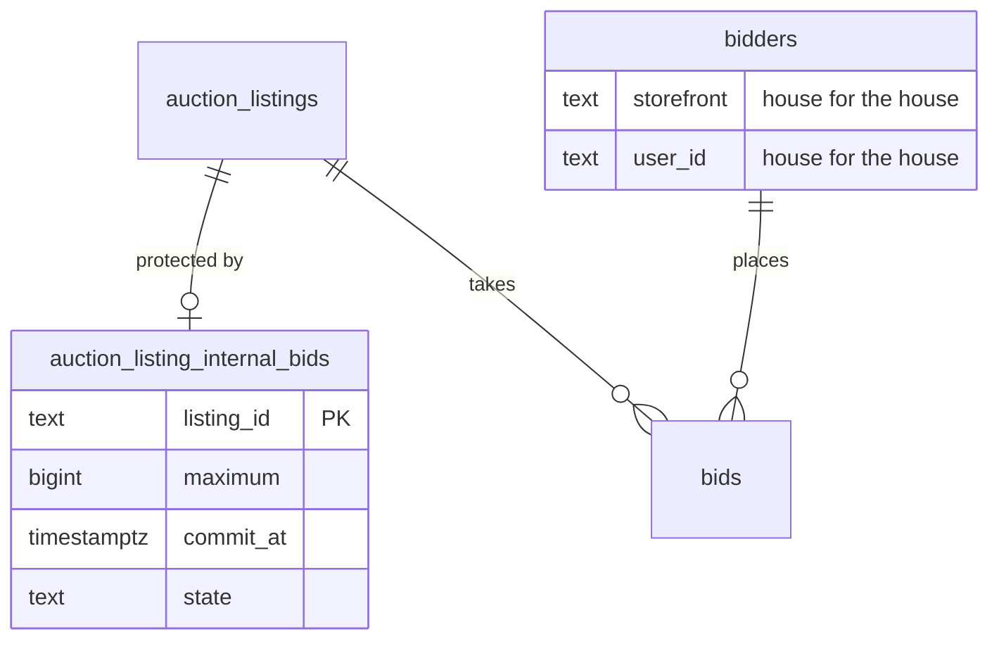

## Context

The auction service already holds every piece the internal bid needs except
the house itself. Motivation is in [proposal.md](proposal.md).

- **One serializer** - every money transition on a lot runs under
  `SELECT … FOR UPDATE` on its `auction_listings` row (`withListingLock`).
  Bids are rows in `auction.bids`, keyed to a bidder by
  `(storefront, user_id)`, each carrying `maximum` and its resolved `amount`
- **One resolution** - `acceptBid` → `resolveStandingMaxima` resolves an
  incoming maximum against the standing ones once, writes the bid rows, the
  bid action group (public and private history) and the extension. A raise
  inserts a superseding row and cancels the old one
- **Clock and settle** - `settleIfDue` commits whichever of publish, extended
  bidding entry or close is due. The lot's `AuctionRoom` Durable Object arms
  one alarm at `nextDeadlineAt` and calls `ROOM_WORK.settle`; a read or a
  refused late bid defers a settle; the five-minute sweep (`sweeps/close.ts`,
  `sweeps/publish.ts`) is the net
- **Close** - `applyClose` moves the top bid to `won`, issues the winner order
  and its mail, then `markUnsoldStockDue` marks the release owed only when
  `isUnsoldForRelease()` holds (no `won` bid, no top bid)
- **Secret floor grant** - `auction:reserve` exists in
  `packages/grade10-auth/contracts`, held by `admin` only, read nowhere. The
  shared tRPC audit middleware writes the raw input unless a procedure
  declares `auditDetails`
- **Leaks to close** - a lot's listing row feeds public projections and its
  version trigger relays to every open page; the operator bid ledger, lot
  activity, bidders list and room inspection all read bids, audit rows and
  alarms that a house bid would touch

## Goals / Non-Goals

**Goals:**

- The house bids through the same resolution, history, extension and close
  code as a collector, so the two-maximum rule cannot drift between them
- The internal bid's amount, time and existence never reach a public read, a
  listing version, or an operator read without `auction:reserve`
- The commit is deterministic: whichever writer reaches the lot first, the
  house's commitment lands at its set time, before anything accepted after it

**Non-Goals:**

- A second resolution engine, or a house bid outside `auction.bids`
- Reporting, exports or a Bought in count beyond the Listings table label

## Decisions

The specs govern what the house may do and what each reader sees:
[`grade10-site/auction/auto-bidding`](specs/grade10-site/auction/auto-bidding/spec.md)
the bidding rules,
[`grade10-admin/auction/internal-bid`](specs/grade10-admin/auction/internal-bid/spec.md)
the admin flow and access,
[`grade10-site/auction/auction`](specs/grade10-site/auction/auction/spec.md)
the close,
[`grade10-site/auction/notifications`](specs/grade10-site/auction/notifications/spec.md)
the letters, and
[`grade10-admin/auction/listing`](specs/grade10-admin/auction/listing/spec.md)
the Listings table, stock and Relist. These are the implementation choices.

1. **The house is a bidder row, not a second engine.** One seeded
   `auction.bidders` row, `(storefront 'house', user_id 'house')`, bids
   through `acceptBid` on every listing. Its per-listing pseudonym is the
   existing `pseudonym_seq`, assigned at its first commit like anyone's.
   `HOUSE_BIDDER` and `isHouseBid(row)` live in the backend's schema module
   so every reader asks one predicate.
   - Rejected: a `house_bids` table resolved beside `bids`. It duplicates the
     two-maximum rule, ties, extension and history, which is exactly what must
     stay identical.
   - Rejected: a bidder row per listing. It multiplies a row nobody reads and
     still needs the same exclusion predicate.

2. **The internal bid lives in its own table.** `auction_listing_internal_bids`
   holds the amount, time and state, one row per listing. Nothing public
   joins it, no version trigger watches it, and Relist copies listing columns
   only, so the draft cannot carry it.
   - Rejected: columns on `auction_listings`. Every public projection, the
     version trigger and the Relist copy read that row, so secrecy would rest
     on remembering to strip three columns everywhere.

3. **Commit before judge.** `commitDueHouseMaximum(tx, listing, now)` runs at
   the head of every writer that holds the listing lock and moves money state:
   `placeBid`'s judgement, `settleIfDue` (start, extended-bidding entry,
   close), the erasure re-stand, and the internal bid's own raise and lower.
   It commits a `scheduled` row whose `commit_at <= now`, with the house
   bid's `created_at` set to `commit_at`. Because every later acceptance
   commits it first, nothing is ever accepted between `commit_at` and the
   commit, so ordering and ties are the same whoever triggered it.
   - Rejected: commit only from the room alarm. A collector bid landing in
     the alarm's latency would be judged without the house, and the result
     would depend on timing.

4. **The room alarm is the trigger; the sweep is the net.** `settleIfDue`
   returns `nextDeadlineAt = min(clock deadline, commit_at of a scheduled
   internal bid)`, so the lot's room wakes at the commit time and the commit
   relays like any bid. `sweeps/internalBids.ts` commits every `scheduled`
   row past its time that nothing reached, through `settleIfDue`, in the
   existing five-minute pass. The room's `inspect` answer reports the lot's
   clock deadline, not the raw armed alarm, so an operator never sees an
   alarm at the commit time.
   - Rejected: the sweep alone. Up to five minutes late is too coarse for a
     commit that may sit seconds before the scheduled close.

5. **Not placed is decided once, at the commit.** The commit runs the
   collector amount rules - the minimum next bid and the accepted-tie rule -
   with the stored amount. A refusal writes no bid and sets the row to
   `not_placed` with `resolved_at`. A raise of a `not_placed` row is a fresh
   commit at `now` through the same path, refused when still short.

6. **A lower is a superseding commitment.** The service re-runs the
   two-maximum resolution in memory with the lower house maximum and the
   house's commitment time set to now. It accepts only when the leader's bid
   row and `top_amount` would be unchanged and the amount is at least the
   highest `amount` on any house bid row on the listing. It then writes as a
   raise does: a new house row at the same amount and state, the old one
   `canceled`, a private `automatic_max_lowered` action and no public record.
   - Rejected: updating `maximum` in place. The reserve holder's ledger would
     lose the previous maximum and its time.

7. **Bought in is derived, not stored.** A closed listing whose `won` bid is
   the house's is bought in. `applyClose` moves the house bid to `won` as for
   any winner, which keeps every public reader on its sold path, and skips
   `issueWinnerOrder`, its order mail and Auction Won analytics.
   `isUnsoldForRelease()` widens to "no `won` bid, or the `won` bid is the
   house's", with release reason `bought-in close` and remark "Released by
   bought-in listing". Relist's source check accepts either.
   - Rejected: a `bought_in` listing status. It would fork every public
     reader that maps status to Ended and sold.

8. **The house is never a recipient.** Every mail and push claim joins
   `bidders` and excludes `storefront = 'house'` through one SQL fragment.
   The mail dispatcher throws on a house recipient, so a missed claim fails
   loudly instead of sending. House bid rows are written with push and mail
   stamps already set, so the partial notify indexes never hold them.
   Collectors' letters use their existing claims unchanged.

9. **One door, one redaction.** `listings.internalBid.{get,save,remove}` are
   `listingProcedure("auction:reserve")`. Their `auditDetails` file
   `{ listingId, act }` with `act` one of `set`, `changed`, `removed`,
   `raised`, `lowered` - never the amount or the time. For a caller without
   `auction:reserve`, the operator reads that touch a lot - Listings table,
   listing record, bid ledger, bidder summaries, lot activity, Stats and the
   bidders moderation list - drop internal-bid staff acts and house identity
   through one `redactHouse(caller)` step in `services/admin`. How a house
   bid row then reads to them is not yet decided and is raised with this
   draft; whatever the answer, `redactHouse` is the one place it lands.

10. **House checks are a separate entry, not flags on `placeBid`.**
    `commitHouseMaximum` calls `acceptBid` after the ceiling and minimum next
    bid checks only: no registration, card, enrollment, suspension, ban,
    watch, idempotency key or Mixpanel Bid Placed event. `placeBid` stays
    unchanged for collectors and refuses `storefront = 'house'` at its entry.

## Database Schema

Owning table: `auction.auction_listing_internal_bids`. Affected:
`auction.bidders` (one seeded row), `auction.auction_listings` (stock release
reason check), `auction.bids` (no column change).

| Column | Type | Null | Default | Note |
| --- | --- | --- | --- | --- |
| `listing_id` | `text` | No | - | Primary key, FK `auction_listings.id` |
| `maximum` | `bigint` | No | - | Minor units in the listing's currency, `> 0` and at most `bidCeiling` |
| `commit_at` | `timestamptz(3)` | No | - | The set time |
| `state` | `text` | No | `'scheduled'` | `scheduled`, `placed`, `not_placed`, `dropped` |
| `resolved_at` | `timestamptz(3)` | Yes | - | When the commit placed it or found it short |
| `updated_by` | `text` | No | - | Operator user id of the last save |
| `created_at` | `timestamptz(3)` | No | `now()` | |
| `updated_at` | `timestamptz(3)` | No | `now()` | |

- **Constraints** - `ck_internal_bids_state`, `ck_internal_bids_maximum`
  (`maximum > 0`), `ck_internal_bids_resolved`
  (`(state in ('scheduled','dropped')) = (resolved_at is null)` for
  `scheduled`; `placed` and `not_placed` require it)
- **Index** - `idx_internal_bids_due` on `(commit_at)` where
  `state = 'scheduled'`, for the sweep
- **No version trigger** - deliberately; a save before the time must not
  relay to open pages
- **`ck_auction_listings_stock_release`** - reason set gains `bought-in close`
- **Seed** - `insert into auction.bidders (storefront, user_id, email)
  values ('house', 'house', 'house@invalid') on conflict do nothing`

Authoritative: the internal bid row for amount, time and state; the house's
bid rows for what was placed. Derived: Bought in (closed, `won` bid is the
house's), Not placed shown to the admin (row state), the house's standing
(bid states).

## Service Interfaces

Every function below runs inside `withListingLock` on the listing named, in
one transaction; a refusal returns before any write.

| Function | Input | Success | Refusal |
| --- | --- | --- | --- |
| `saveInternalBid` | `{ listingId, maximumMinor, commitAt, actorId }` | `{ state, maximumMinor, commitAt }` | `NOT_EDITABLE`, `TIME_OUTSIDE_WINDOW`, `TIME_PASSED`, `TIME_FIXED`, `AMOUNT_TOO_HIGH`, `INVALID_AMOUNT`, `NOT_RAISED_OR_LOWERED` |
| `removeInternalBid` | `{ listingId, actorId }` | `{ removed: true }` | `TIME_FIXED`, `NOT_FOUND` |
| `commitDueHouseMaximum` | `(tx, listing, now)` | `placed`, `not_placed` or `none` | Never refuses; throws on a broken invariant |
| `raiseHouseMaximum` | `(tx, listing, row, maximumMinor, now)` | the resolution | `AMOUNT_TOO_LOW` with `minimumNextAmount`, `NOT_BIDDABLE` |
| `lowerHouseMaximum` | `(tx, listing, row, maximumMinor, now)` | `{ lowered: true }` | `MOVES_LEAD_OR_PRICE`, `BELOW_HOUSE_BID` with `floorMinor` |
| `readInternalBid` | `{ listingId }` | `{ maximumMinor, commitAt, state, currency } \| null` | `LISTING_NOT_FOUND` |

`saveInternalBid` routes by state: `scheduled` or no row writes the row
(after `commit_at` has passed it is `TIME_FIXED` for the time and routes the
amount instead); `placed` and `not_placed` route a higher amount to
`raiseHouseMaximum` and a lower one to `lowerHouseMaximum`, and refuse any
`commitAt` other than the stored one. Every path calls
`commitDueHouseMaximum` first.

**Mutation order for a commit** - under the listing lock: read the internal
bid row; insert the house bid row(s) and the bid action group through
`acceptBid` (which also updates `auction_listings.top_amount`,
`current_top_bid_id` and `ends_at`); update the internal bid row to `placed`
and `resolved_at`. All in the caller's transaction; the commit is never its
own transaction when another writer triggered it.

Example - HKD listing `auc_7f`, start 20000, A's maximum 30000 leading at
20000, internal bid 50000 at `2026-11-02T10:00:00.000Z`; a collector bid
arrives at `10:00:04Z`:

| Row | Before | After |
| --- | --- | --- |
| `auction_listing_internal_bids` | `scheduled`, `resolved_at` null | `placed`, `resolved_at 10:00:04.000Z` |
| `bids` (house) | none | `maximum 50000`, `amount 31000`, `state top`, `pseudonym_seq 2`, `created_at 10:00:00.000Z` |
| `bids` (A) | `top`, 20000 | `outbid` |
| `auction_listings` | `top_amount 20000` | `top_amount 31000`, `current_top_bid_id` the house bid |

The collector's bid is then judged against a lot the house leads at 31000.

**Identity across the boundary** - admin browser → `auction-admin` tRPC with
the operator session → `elevatedProcedure` checks `auction:reserve` and
writes the redacted audit row → `saveInternalBid` → repositories. The house
never crosses a storefront; no storefront backend can name
`storefront 'house'`, and `placeBid` refuses it.

## API Contracts

- **New admin reads and writes** - `listings.internalBid.get`
  `{ listingId } → { maximumMinor, currency, commitAt, state } | null`,
  `listings.internalBid.save` `{ listingId, maximumMinor, commitAt }`,
  `listings.internalBid.remove` `{ listingId }`, all `auction:reserve`
- **Admin listing item** - additive `boughtIn: boolean`, true only once the
  lot has ended with the house's bid on top, for every caller who can read
  the Listings table
- **Auth contracts** - `auction:reserve`'s description becomes "Set and read
  a listing's internal bid." No grant moves
- **Public contracts** - unchanged; the house's bids and win read as a
  collector's

## Risks / Trade-offs

- **[A missed exclusion mails or lists the house]** → one SQL fragment and
  `isHouseBid` used by every claim and operator read, a dispatcher assertion
  that throws on a house recipient, and a backend test walking every mail
  claim with a house bid present
- **[The commit fires late and a lot already read as ended reopens]** - a
  commit just before the scheduled close, missed by the alarm, would land at
  the close settle and put the lot into extended bidding after a reader
  computed it ended → the room alarm is armed at `commit_at`, a read finding
  a due commit defers a settle, and `auction.internal_bid.commit_lag_ms`
  (distribution, no tags) pages on lag above 30 seconds
- **[The commit time leaks through the room]** → `inspect` reports the
  clock deadline; the room relays only after a commit writes a bid, which is
  public anyway
- **[Staff learn a lot is protected from operator reads]** → `redactHouse`
  is the only path from bid rows to operator answers, with a test per read
  calling it as `staff` on a protected lot
- **[An audit row carries the amount]** → `auditDetails` declared on every
  internal-bid procedure, and the audit walker test refuses an
  `auction:reserve` procedure without it
- **[A lower that looks harmless moves the price]** → the lower is judged
  by the same resolution function the commit uses, not a second rule

## Migration Plan

1. Migration: create `auction_listing_internal_bids`, widen the stock
   release reason check, seed the house bidder. Additive; old code ignores
   all three
2. Deploy the backend with the commit, close, mail and redaction paths. No
   internal bid exists yet, so behaviour is unchanged
3. Deploy the admin frontend section and the auth description
4. Rollback: revert the frontend and backend. Rows already `placed` keep
   their house bids, which old code closes as an ordinary winner and would
   issue an order for; before rolling back, call off or hand-resolve any
   protected published lot. Drop the table only after none remain

## Open Questions

- The `commit_lag_ms` page threshold of 30 seconds is a first guess, tuned
  after a week of real commits
