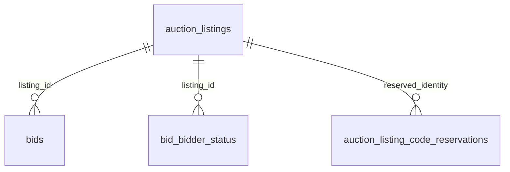

## Context

The [decisions](decisions.md#decisions) govern the address outcome. Application facts were checked at `908b12408f8ab0b7b54c8570876bfd346832276b`.

| Application Path | Relevant Fact |
| --- | --- |
| `packages/grade10-auction/backend/src/services/admin/admin.ts` | `adminCancelListing` calls `withListingLock`; the listing transition preserves its slug |
| `packages/grade10-auction/backend/src/services/auctions/events.ts` | Campaign cancellation commits the parent first, then calls the same listing cancellation service; the repair sweep resumes this fan-out |
| `packages/grade10-auction/backend/src/repositories/listings.ts` | Availability checks every retained slug and code reservation; public lookup refuses code-only addresses before finding a slug holder |
| `packages/grade10-auction/backend/src/db/schema/listings.ts` | `slug` is nullable; `uq_auction_listings_slug` reserves every non-null case-insensitive value |
| `packages/grade10-auction/backend/src/services/listings/publicState.ts` | `publicLot` permits a canceled row with a listing code and requires a complete row afterward |
| `packages/grade10-auction/backend/src/services/accountRecord.ts` | Bidder records join by stable listing identity and already carry a nullable slug |
| `apps/backend/grade10/auction/src/db/migrations/0003_funny_serpent_society.sql` | Existing migration history changed the index to reserve canceled slugs too |

## Decisions

- **Released Slug** - The [listing contract](specs/grade10-admin/auction/listing/spec.md) governs reuse. Store `null` in the existing slug column when a listing is canceled. This deterministic absence releases the unique key without inventing a private address, a namespace, a reservation table or an alias.
- **Existing Index** - Keep the case-insensitive index on all non-null slugs. A partial index excluding canceled rows would permit multiple rows with the same stored value and make current-holder lookup ambiguous. Clearing the value preserves one holder per address.
- **Public Visibility** - The [listing-page contract](specs/grade10-site/auction/listing-page/spec.md) governs not found and the eligible holder. Refuse every canceled row in the shared public projection before completeness checks. Apply the same hidden policy to public live readers. A null slug alone is insufficient because internal-id public readers also exist.
- **Bidder Identity** - Preserve the listing row, listing code, permanent code reservation, bid rows and bidder standings. Account reads stay keyed by listing id. Retain existing handling for nullable account-record addresses so a called-off history row cannot navigate to an unrelated lot that reuses its former slug.
- **Status Derivation** - Keep the bidder and admin clock rules needed to classify a canceled record. Remove the public visibility exception at the public boundary; changing all canceled-clock derivations would unnecessarily change bidder history and admin counts.
- **Overlap** - This change owns `Collectors never see hidden lots`. `clarify-auction-shipping-progress-copy` owns `Every visible lot has one external lot status`. The inspected delta changes that other requirement only. Neither change replaces the other's requirement or order-status mapping.

## Database Schema

No column, type, key or index changes. The existing data model holds the result.

| Table | Authoritative Fields | Change |
| --- | --- | --- |
| `auction.auction_listings` | `id`; nullable `slug text` with no default; `status`; `listing_code` | Canceled rows store no slug |
| `auction.auction_listing_code_reservations` | Permanent code and listing identity | No change or deletion |
| `auction.bids`, `auction.bid_bidder_status` | Bid and bidder history for the stable listing id | Existing cancellation transitions retained |

## Service Interfaces

| Processor | Input | Success | Refusal |
| --- | --- | --- | --- |
| `adminCancelListing` | Existing `listingId`, clock, event port, optional inventory port and settle callback | Existing success with no data | Existing missing or not-cancelable result |
| `cancelAuction` / `cancelListingsOf` | Existing campaign id, limit, clock and service ports | Existing canceled listing ids and remaining count | Existing campaign refusal; failed listing work remains repairable |
| Slug availability and draft/create writes | Existing selected slug and optional current listing id | Existing availability result or stored listing | Existing malformed, reserved or locked refusal |
| Public slug lookup | Existing slug and sandbox visibility | Eligible current holder's public projection | Existing null/not-found result |

**Listing Transaction** - Keep cancellation in `withListingLock`. The row lock serializes cancel, bid and close. Under that lock, validate the current status and effective close, cancel standing bids, update the listing status and clear its slug in the same statement, then record bidder standings. Retain the existing inventory release call and failure propagation. The auction database commit contains the status, released slug and bid facts together; inventory is a separate service and is not part of that database's atomic boundary.

**Identifier Race** - Retain the existing namespace lock for draft/create writes and code allocation. Clearing a slug does not allocate another identifier, so cancellation needs no namespace lock. Before its commit, availability can still report unavailable; after commit, one writer can reserve the released value. Two reuse writers still serialize through the existing namespace lock and unique index. No writer can observe committed canceled status with the old slug still retained. A failed cancellation transaction retains both the old status and slug.

**Campaign Transaction** - Retain parent-first cancellation and bounded listing fan-out. Each successful listing transaction releases its own slug. Listings not reached remain on the existing repair work list; a later sweep calls the same cancellation service. Do not make the parent and every listing one transaction or reverse campaign/listing lock order.

**Request Identity** - The admin form sends the listing id through the elevated cancellation procedure. The service and repositories use that identity throughout. A collector sends the address slug through either the served route or client reader; code-only refusal runs first, current slug lookup finds one row, and shared visibility decides whether it can be public. The response and metadata use the current holder, without enrichment from the canceled row.

| Example | Before | Committed Result |
| --- | --- | --- |
| Cancel `lot-a` | `published`, slug `charizard-psa-9`, code `LK423`, standing bids | Same row and code; `canceled`, slug null, called-off bids and bidder history |
| Save `lot-b` after cancel | Draft with its own code and selected slug `charizard-psa-9` | `lot-b` holds the slug; public lookup remains not found until it is eligible |
| Publish `lot-b` | Created `lot-b` holding that slug | Address answers `lot-b`, with its title, description and canonical metadata |
| Cancel loses to close | `lot-a` closes under the shared row lock first | Cancel refuses; closed slug and outcome remain intact |

## Risks / Trade-offs

- **Incomplete Public Projection** - Clearing the slug makes a canceled row incomplete for public projection. Refuse canceled status before completeness validation and cover the public-id and live paths with tests.
- **Historical Rows** - A future-only service fix leaves old slugs reserved. An idempotent data migration clears every existing canceled row with a non-null slug, including old private rewrite values. Codes and history stay untouched.
- **Serving Freshness** - Exercise warm public reads, a fresh served document and client navigation after call off and reuse. Retain existing listing-tag invalidation and inspect campaign cancellation's invalidation path. Third-party cached previews keep the existing no-purge guarantee; they do not define current origin lookup.
- **Migration Ordering** - The current public projection can throw after clearing a retained slug. Deploy the visibility refusal before backfill; prevent an old cancellation writer from restoring retained slugs while the release writer and backfill roll out.
- **Rollback** - Reuse can assign an old address to a different listing. Do not restore canceled slugs or old retained-address behavior after reuse. Roll back only to a build that preserves null canceled slugs and hidden public projection, or disable the affected writes while repairing forward.

## Migration Plan

1. Add failing service, lookup, bidder-history and migration tests before their implementation commits.
2. Deliver public refusal for all canceled rows and the atomic release writer. Verify nullable account-record addresses and existing cancellation notification handling.
3. Append a migration that clears `slug` where `status = 'canceled'` and `slug IS NOT NULL`. Keep previous SQL, journals and snapshots intact. Include the populated-table lock and contract acknowledgements; rehearse with retained, previously rewritten and null canceled slugs, alongside draft, created, published, closed and settled controls.
4. Apply in the auction deployment window with incompatible writers stopped. Verify no canceled row retains a slug and code reservations and history are unchanged. A second execution changes no rows.
5. Verify operator and campaign call off, campaign repair, reuse in draft and after publication, no-holder 404, code-only refusal, and bidder history through the application interfaces.
