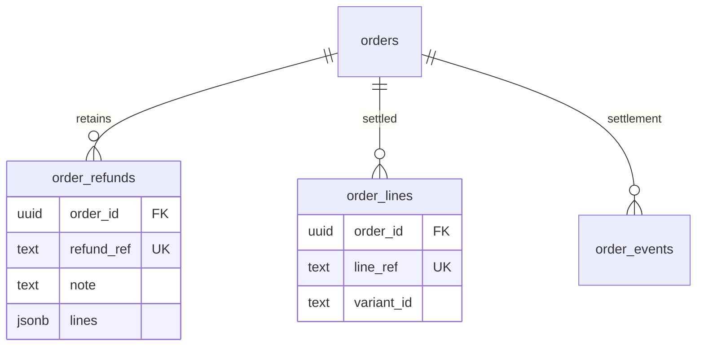

## Context

Application source inspected from `grade10` fetched `origin/main` at **72d96ee33a21c996c42261ed6bbbcd16ea27dec9**, using `git show`, rather than the working checkout. The store planning baseline is **8f5253a3ceb842d7706f9ad274652dbaa439260f**. Motivation and product decisions remain in [proposal](proposal.md) and [decisions](decisions.md).

| Existing source | Relevant fact |
| --- | --- |
| `packages/shopify/backend/src/admin/orders.ts`, `webhooks/payloads.ts` | Shopify refunds already carry `note`; webhook decoding collapses missing to null and excludes restock-only deliveries. Refund creation writes its idempotency key as the note and finds it by exact equality. |
| `packages/grade10-store/backend/src/adapters/shopify/{events,shopifyProvider}.ts` | Both adapter arms drop notes. Webhook pending-money and provider-read nonpositive-money filters must continue governing settlement, but cannot govern metadata capture. Both already carry provider-created refund timestamps. |
| `backend/src/services/refund.ts` under `packages/grade10-store` | `recordRefund` locks the order, returns early for old/unkeyed or deduplicated money, and can create `<ref>@<amount>` event keys for later settled money. Those are settlement keys, never new refund identities. |
| `backend/src/db/schema/orders.ts`, `services/orders/readOrder.ts` | `order_lines` retains unique `(order_id,line_ref)` identities; returned units currently aggregate by variant. This projection cannot carry distinct refund reasons. |
| `backend/src/services/{fulfillment/refresh,reconcile/reconcile,external/ingest,webhooks}.ts` | Existing provider pulls and webhook ingestion converge on settlement recording. Buyer reads repair through these paths; ordinary read refresh stops after 90 days. |
| `backend/src/trpc/routers/orders.ts`, `erasure/eraseUser.ts` | Authorization precedes repair/enrichment. Erasure clears private purchase text and link tokens, but orders have no durable refund-note erasure guard today. |

## Goals / Non-Goals

Retain provider refund metadata independently from money, and return one additive detail projection with exact source attribution. Reuse existing verified ingress, order locks, provider registry, read claims and erasure boundary. No frontend, shared UI, publication state, reason mapping, new dependency, settlement algorithm or idempotency change.

## Decisions

1. **One metadata row per provider refund.** The [delta contract](specs/grade10-site/store/order-detail/spec.md) governs retention and optional exposure. Add one `order_refunds` table rather than placing text on cumulative order totals or on deduplicated financial events. Those cannot represent pending/restock-only refunds, multiple notes or late metadata after financial dedupe. Store source line references together as a JSONB value; refund metadata is loaded as a whole and needs no independently queried association table. Existing `order_lines` is the authority for enriching an explicitly named source line with a known variant.
2. **Separate metadata from settlement inputs.** Add a backend `PaymentRefundMetadataFact` and optional `refundMetadata` on provider results/events. Its fixed shape is `{ref:string, note?:string|null, refundedAt?:Date|null, lines?:readonly {ref:string,quantity:number|null}[]|null}`. Read metadata from every source refund before financial filters. Keep `PaymentRefundFact`, all money filters and original refund idempotency keys unchanged. Add a metadata-only webhook decoder sharing the existing verified payload schema; do not make restock-only money parse as a payment refund. Preserve own-property absence rather than `note ?? null` for metadata.
3. **Canonical read precedence, no revision model.** A provider order read is authoritative when it supplies `note`; it replaces or clears the note. Omission is no update. A verified webhook fills a note only when no note has been captured, and never overrides a canonical-read answer, including explicit empty. A nullable `note_source` is the minimum provenance needed to distinguish unknown from canonical empty. It is not a publication workflow or source revision. Existing claimed provider reads serialize normal refresh; an operator replay uses the same claim. With no source revision, two canonical source snapshots cannot be proven chronologically ordered; commit order under the existing claim is the supported policy, with the next canonical read correcting the value. Never claim source-version freshness.
4. **Explicit associations, no item-note copies.** Persist the source line refs even when not found in settled `order_lines`. Derive an optional `variantId` only by exact `(order_id,line_ref)` lookup. Do not attach notes through the current variant-only returned-quantity map. Repeated refunds for one line remain separate rows; shipping-only `[]` and unknown `null` associations remain distinct. A supplied canonical associations value replaces that refund's associations; omission preserves them. Webhooks fill unknown associations and do not overwrite known canonical facts. Refund `createdAt` is event time, not a note-update version.
5. **Durable erasure wins.** Add an order-level `refund_notes_erased_at` guard, because deleting text alone lets the next sync restore it. Under the same order lock, erasure sets the guard and clears every retained note/source for orders in its existing person scope, including orders reached through the provider customer reference before that reference is cleared. Future metadata capture may retain non-personal refund identities/line facts but never writes note text on guarded orders. Do not infer erasure from a missing email or link token.

## Database Schema

Both Grade10 and ZZZ Store deployments consume the shared Store schema; generate both migrations through the repository workflow. Existing `orders`, `order_lines`, `order_events` and loyalty tables keep their financial meaning.

| Table / column | PostgreSQL type | Nullability / default | Meaning |
| --- | --- | --- | --- |
| `orders.refund_notes_erased_at` | `timestamp with time zone` | nullable; no default | Durable erasure guard; same order lock as metadata writes. |
| `order_refunds.id` | `uuid` | primary key; `defaultRandom()` | Local row identity. |
| `order_refunds.order_id` | `uuid` | non-null; no default | FK to `orders.id`, cascade on deletion. |
| `order_refunds.refund_ref` | `text` | non-null; no default | Original provider refund id, scoped by the order's immutable provider. |
| `order_refunds.note` | `text` | nullable; no default | Exact non-empty source string; null for blank/empty/unknown/erased. |
| `order_refunds.note_source` | `text` | nullable; no default | `webhook` or `provider_read`; null means no note answer captured. Empty canonical answers retain `provider_read`. |
| `order_refunds.refunded_at` | `timestamp with time zone` | nullable; no default | Provider issue time; no invented date. |
| `order_refunds.lines` | `jsonb` | nullable; no default | Array of `{ref,quantity}` source line facts; `[]` means explicitly no lines. |
| `order_refunds.lines_source` | `text` | nullable; no default | Same two values, only to protect canonical associations from delayed webhook overwrite. |

Unique `(order_id,refund_ref)`; its leading order id supports detail reads without another index. Checks restrict non-null source values to the two declared origins, require note null when `note_source` is null, and require line quantities to decode as non-negative integers or null at the repository boundary. Source omissions update no corresponding column. No `published`, approval, source-revision or second financial amount columns.

`order_refunds.lines[].ref` joins logically to `order_lines.line_ref` within that order; it is deliberately not an FK so an unknown or later-added source line is retained faithfully. Variant attribution is derived on read, never duplicated as stored authority.

## Service Interfaces

**Metadata processor:** `recordRefundMetadata(store, {orderId, source:'webhook'|'provider_read', refunds:readonly PaymentRefundMetadataFact[]})` returns `{outcome:'written',refunds:number}` or `{outcome:'unknownOrder'}`. It owns a transaction when called alone; callers already owning a transaction pass that transaction. Lock the order first, read the erasure guard, then upsert metadata by original refund identity. Apply source precedence field by field, canonical supplied null/blank clearing, absent preserving, and exact-text preservation after trim-for-emptiness only. Never write totals, returned quantities, status, stock, promotions or financial outbox. Database failures propagate to verified ingress or roll back the enclosing pull; the existing read refresh catches failures and serves last-known order facts. No raw note appears in diagnostic context or analytics.

**Ingress boundaries:** signature verification and provider-order resolution remain at the existing webhook door. Extract metadata separately from money and capture it before the financial dedupe/early-return branch; even an event already financially remembered can enrich metadata after verification and resolution. Unknown orders gain no orphan row. Existing retry/provider ingestion remains the repair route for orders not yet resolved. Pending and restock-only inputs carry metadata without asking the status machine for a refund transition. Provider `findPayment` and external-order fact mapping return all refund metadata before `orderRefunds` filters settled money. Each reconciliation, external ingestion and `pullSettlementSnapshot` caller passes that metadata into the processor even if `recordRefund` has nothing to record. Do not feed metadata into loyalty or inventory.

**Atomic mutation order:** webhook metadata-only work locks order → checks erasure → upserts metadata → commits; financial dedupe remains independent and cannot undo successful metadata enrichment. Provider settlement pull keeps its existing transaction: existing settlement snapshot writes → metadata capture under the same order lock → existing money-recording loop → completion → commit. A new financial event and its metadata therefore either commit together in that pull or neither does. Erasure locks order → sets `refund_notes_erased_at` → nulls metadata text/source → performs existing private-fact clearing in that transaction; a concurrent note upsert must observe the guard or precede text removal. Avoid provider network requests while holding database locks.

Example: order `o1` has one settled line `L1` for variant `V1`, refunded amount 2000 HKD minor units, and its original financial event `R1` is present. Input `{orderId:'o1',source:'provider_read',refunds:[{ref:'R1',note:'  Damaged corner\n',refundedAt:2026-11-02T00:00:00Z,lines:[{ref:'L1',quantity:1}]}]}` writes one metadata row and returns `{outcome:'written',refunds:1}`. Financial event count, refunded totals, points and stock do not change. Repeating it retains one row. A canonical `{ref:'R1',note:null}` clears reason without clearing associations; `{ref:'R1'}` changes neither. Later webhook text cannot restore that canonical-empty note. On an erased order neither source writes a note.

**Detail projection:** add `withRefundReasons` beside existing buyer detail enrichment, after authorization and any repair. Load refund rows once, resolve only explicit source line refs against settled lines, omit blank/erased `reason`, and sort by issue time ascending, unknown times last, then provider ref ascending for ties. Apply to owner `get`, `byLink`'s nested order, and the legacy guest detail path. Do not enrich list/admin/catalog/search models; shared optional schema use alone grants no data. No aggregate `refundedMinor > 0` guard: a pending/restock-only note is retrievable without a money assertion.

**Historical replay:** existing buyer refresh backfills eligible orders opportunistically. Older-than-90-day orders are not newly made to call Shopify on every read. Supply an operator-only bounded metadata replay command using existing provider registry and read-claim protection, with explicit order IDs, dry-run default, no financial recorder, and safe counters. It calls the same processor with canonical metadata and cannot restore erased text. Missing provider metadata leaves a successful detail unchanged; no historical reason is manufactured. Planning does not run that command against production.

## API Contracts

Only the existing authorized Store order detail responses gain optional `refunds`; consumers can still decode a legacy response without it. When present, it is an array of these records; empty means no retained refund records. It is not a statement that money has settled.

| Field | Wire contract |
| --- | --- |
| `ref` | Required original provider refund identity, unique within the order. |
| `at` | Optional date through the current contract date codec; absent when issue time is unknown. |
| `reason` | Optional string, exact supplied non-empty text; absent when unknown, null, blank or erased. Never null/HTML. |
| `lines` | Required array or null: `[]` names no line; null means source attribution unavailable. |
| `lines[].ref` | Required exact source order-line identity. |
| `lines[].quantity` | Required non-negative integer or null when not stated. |
| `lines[].variantId` | Optional exact-match settled-line variant; absent for unresolved or variantless lines. |

Both owner and valid private-link detail receive the same refund metadata, subject to the existing no-account-facts projection on private links. Wrong secret, unknown order or unowned member read returns its existing refusal before metadata lookup. No new endpoint or access grant; no frontend rendering or new shared UI contract.

## Risks / Trade-offs

- [Meaningful machine notes] → retain exact text and leave idempotency creation/equality checks untouched, as Q1/Q5 require.
- [Source omission accidentally erases text] → presence-aware metadata decoding and source-specific upsert tests; no `?? null` collapse on the metadata route.
- [Delayed webhook replaces a canonical correction] → per-field source stamps, including canonical-empty answers, and order locking.
- [Pending metadata presented as settled money] → metadata has no amount/status; original financial filters and tests remain unchanged.
- [Erasure races or sync restoration] → durable order guard checked under the same lock, plus status counting of surviving note text and race tests.
- [Old orders outlive automatic refresh] → explicit bounded metadata-only replay; no new global scanning job or claim of complete backfill before replay.

## Migration Plan

1. Add nullable columns/table to the shared Store schema and generate Grade10/ZZZ migrations with `pnpm db:drizzle:generate`; inspect generated SQL and run `pnpm check:migrations` plus both isolated migration lanes.
2. Deploy additive schema before writers/readers. Existing workers and clients ignore the new optional facts. No historical text is fabricated by SQL.
3. Roll out presence-aware adapters, processor, erasure guard, optional contracts and detail projection. Verify on an isolated stack before any operator replay; keep deployment and production replay outside planning.
4. Roll back application changes without dropping the additive metadata schema or erasure guard. A later rollout must continue respecting that guard. A destructive rollback of stored reason data is a separate operator action.
