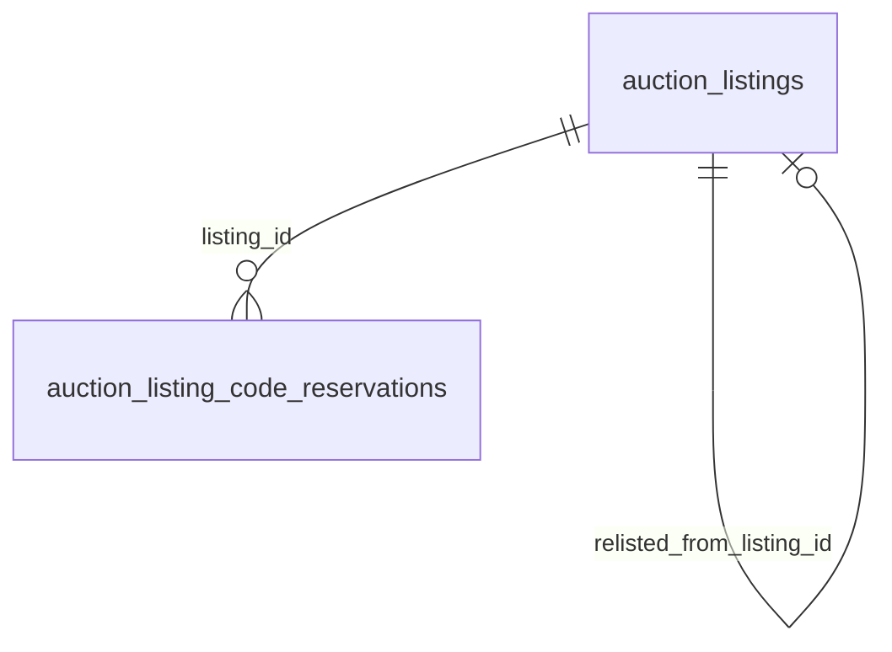

## Context

Application facts checked at `0385503c15994a4595a96c9a1aebb05ae137f0a2`
(`/tmp/grade10-plan-relist-slug-transfer`).

| Application path | Relevant fact |
| --- | --- |
| `packages/grade10-auction/backend/src/services/listings/draft.ts` | New-listing `saveListing` inserts under `lockListingIdentifierNamespace`; slug is `nextSlug ?? generatedListingSlug(title, listingCode)`; Relist sets `relistedFromListingId` and copies media; it does not touch the Unsold source row |
| `packages/grade10-auction/backend/src/services/listings/relist.ts` | `readRelistSource` validates Unsold, no campaign, stock released, not already relisted; reads source media |
| `packages/grade10-auction/backend/src/services/listings/slug.ts` | `checkListingSlugAvailability` / `listingSlugTaken` except an optional `listingId` only; Relist editor has no listing id yet |
| `packages/grade10-auction/backend/src/repositories/listings.ts` | `uq_auction_listings_slug` reserves every non-null case-insensitive slug; `exceptListingId` skips one holder |
| `packages/grade10-auction/admin-frontend/.../listingForm.ts` | Relist fills product, copy and price from the source; `slug` is taken only from a stored listing, so Relist opens with an empty Web address |
| `packages/grade10-auction/backend/src/services/admin/listingActivity.ts` | Source shows derived `relistedAs` with the successor id; successor `created` carries `relistedFromListingId`; neither names the slug |
| `packages/grade10-auction/admin-frontend/.../activityRows.tsx` | Labels: "Relisted as the new draft …" / "Listing created, relisted from …" |

## Goals / Non-Goals

**Goals:**

- **Transfer on Relist Save** - free the Unsold source slug and assign the form slug to the new draft in the same Auction transaction that inserts the draft
- **Prefill and override** - Relist editor opens with the source slug; Save stores whatever the form holds and still frees the source's former value
- **No generated overwrite** - when the form sends a slug, Relist Save must not replace it with `generatedListingSlug`
- **Activity names the move** - both listings' activity name the slug the successor holds and the other listing
- **Field-exit exception** - before the first Relist Save, availability treats the source's current slug as free for that Relist draft

**Non-Goals:**

- **No redirect table** - one canonical holder; no alias, history table or HTTP redirect
- **No listing-code reuse** - successor still receives a new code through `reserveListingCode`
- **No call-off rewrite change** - completed, expired and other unsold holders still reserve; only the Relist source is freed on that Relist Save
- **No public draft** - draft and created still do not answer at the address (Q8)

## Decisions

The [listing delta](specs/grade10-admin/auction/listing/spec.md) and
[decisions](decisions.md#decisions) govern the product outcome. Implementation
choices below inherit those rows.

### Relist Save Transaction

- **Free then assign in one commit** - Inside the existing new-listing
  transaction in `saveListing`, when `relistOf` is set: after
  `lockListingIdentifierNamespace` and before the uniqueness check that
  admits the form slug, clear the source row's `slug` to `null` (same pattern
  as call-off release), then insert the draft with the form slug (or the
  generated value when the form slug is empty). Source status, code, bids and
  outcome stay unchanged.
  - Rejected: delay the move until Publish. Q2 and Q8 require the closed page
    to stop answering at Save, and the draft still not to answer until
    published.
  - Rejected: a slug-history or redirect table. Q5.
- **Form slug wins over generation** - Keep `nextSlug ?? generatedListingSlug`.
  Relist prefill and Save must send the form value as `slug` so generation
  never invents a title-and-new-code address over a transferred one. Empty
  form slug still generates, and the source's former slug is still cleared.
- **Uniqueness exception is the cleared source** - After the source clear in
  the same transaction, ordinary `listingSlugTaken` for the new id succeeds
  for the transferred value. No second reserved namespace. Other closed,
  settled or unsold holders still collide.
- **Source row lock** - Lock the Unsold source under the same identifier
  namespace lock already held for code and slug allocation, so a concurrent
  Relist Save still serializes on `uq_auction_listings_relisted_from_listing_id`
  and cannot observe the source still holding the slug after this Save
  commits.

### Admin Prefill And Availability

- **Prefill from source** - `formOf` sets `slug` from `listing?.slug ??
  relistSource?.slug ?? ""` so Relist opens with the public address filled;
  listing code and window stay empty.
- **Field-exit excepts the Relist source** - Extend
  `checkListingSlugAvailability` (and the `slugAvailability` input) with
  optional `relistOf`. When present and the asked slug equals that source's
  current slug, treat it as available (do not disclose other private fields).
  After the first Save the draft has its own `listingId` and the source no
  longer holds the value, so the ordinary except-self path covers later
  edits.
  - Rejected: client-only "available" while the source still holds the slug.
    Save would still refuse today without the transfer; field-exit must match
    Save.

### Activity

- **Enrich derived lifecycle, do not invent a second log** - Extend
  `relistedAs` with the successor's stored slug and keep the successor id;
  extend Relist `created` with that same slug beside `relistedFromListingId`.
  Read the slug from the successor row at activity aggregation time (it is
  the form value stored on Save). Update admin activity copy to name the slug
  and the other listing by listing code and English title when present, else
  the listing id (Q10).
  - Rejected: a new staff-act audit only. Operators already read lifecycle
    Relist rows; a silent audit would miss Q6's operator-facing requirement.
  - Rejected: storing a second `transferred_slug` column. The successor row
    already holds the address after Save; recompute from that row.

### Public Lookup

- **No site change beyond holder** - Public slug lookup already answers the
  current holder that is published, closed or settled. After Relist Save the
  source no longer holds the slug and the draft does not answer, so the
  address is not found until Publish; after Publish the successor answers.
  No redirect layer.

## Database Schema

No column, type, key or index changes. Clearing `auction.auction_listings.slug`
on the Unsold source reuses the nullable column and the existing unique index.

| Table | Authoritative fields | Change |
| --- | --- | --- |
| `auction.auction_listings` | nullable `slug`; `relisted_from_listing_id`; `listing_code` | Relist Save nulls the source slug and stores the form slug on the new draft |
| `auction.auction_listing_code_reservations` | Permanent code per listing | Unchanged; successor still reserves a new code |

## Service Interfaces

| Processor | Input | Success | Refusal |
| --- | --- | --- | --- |
| `saveListing` with `relistOf` | Existing Relist args plus form `slug` (optional empty) | New draft holding the form or generated slug; source slug null; distinct listing code; media copied; `relistedFromListingId` set | Existing Relist refusals; `SLUG_TAKEN` when another non-source holder retains the form slug; ordinary draft refusals |
| `checkListingSlugAvailability` | `slug`, optional `listingId`, optional `relistOf` | `{ slug, available }` | Malformed slug reports unavailable; never names the conflicting listing |
| Listing activity read | Existing listing id | Lifecycle entries naming slug on Relist transfer rows | Existing |

**Mutation order (Relist Save, one Auction transaction):**

1. Validate Relist source (`readRelistSource`)
2. `lockListingIdentifierNamespace`
3. Clear source `slug` to `null` when it still holds a value
4. Reserve successor listing code
5. Resolve slug: form value, else `generatedListingSlug(title, listingCode)`
6. Refuse if that slug is taken (source already cleared)
7. Insert draft with `relistedFromListingId`, hold inventory, copy media

| Example | Before | Committed result |
| --- | --- | --- |
| Relist Save keeps source slug `umbreon-v-alt` | Source closed Unsold holds `umbreon-v-alt`, code `LK423` | Source slug null, code `LK423`; draft holds `umbreon-v-alt`, new code; public lookup not found |
| Operator replaces with `umbreon-again` before Save | Source holds `umbreon-v-alt` | Source slug null (former freed); draft holds `umbreon-again`; `umbreon-v-alt` free for others |
| Operator clears Slug before Save (Q11) | Source holds `umbreon-v-alt`, title `Umbreon V` | Source slug null (former freed); draft holds title-and-new-code slug; `umbreon-v-alt` free for others |
| Publish successor | Draft holds `umbreon-v-alt` | Address answers the successor |

## API Contracts

- **`listings.slugAvailability`** - add optional `relistOf` (listing id). Additive; existing callers omit it.
- **Listing activity lifecycle** - `relistedAs` gains `slug` (string); Relist `created` gains optional `slug` when `relistedFromListingId` is set. Additive contract fields for the admin activity reader and labels.

## Risks / Trade-offs

- **[Unique-index race with a non-Relist writer]** → Keep the identifier namespace lock around clear, check and insert so a concurrent Save cannot commit the same slug beside the Relist draft.
- **[Activity slug drifts if the operator later edits the draft slug]** → Accept recompute from the successor row; the Save-time transfer is what Q6 records, and a later draft slug edit is its own change visible on the successor.
- **[Field-exit `relistOf` forged to another listing]** → Availability never discloses private fields; Save still refuses a slug held by a listing that is not this Relist's validated source after the source clear. Optional: ignore `relistOf` unless it matches the Save's `relistOf` path; the blur check is advisory only.
- **[SC-135 and admin tests expect an empty Web address]** → Update those tests with the prefill behaviour in the same group that changes `formOf`.

## Migration Plan

1. Land failing backend Relist Save / availability / activity tests, then the transaction and contract fields.
2. Land failing admin prefill, field-exit and activity label tests, then form and copy changes.
3. No data migration: only future Relist Saves transfer; already-relisted pairs keep today's split addresses.
4. Verify: Relist Save, operator override, mid-window 404, Publish opens the successor, activity on both, ordinary closed slug still reserved, call-off release unchanged.
5. Rollback: revert the writers; transferred rows already null on the source stay null (same as call-off release). Do not restore source slugs after a successor has published at that address.
